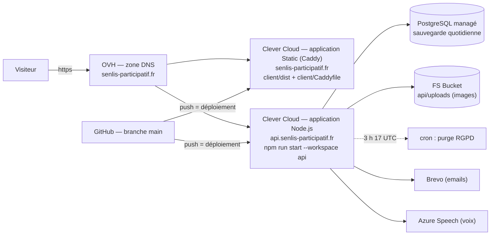

# 34 — Procédure de mise en ligne (S5-22)

> **But** : passer du téléporteur à **https://senlis-participatif.fr**, chez un hébergeur français (Clever Cloud), avec des secrets neufs et une branche `main` protégée.
>
> **Durée** : une demi-journée de manipulations, plus jusqu'à 24 h d'attente pour la propagation des DNS.
>
> **Ce document remplace** `guide-clever-cloud.docx` (août 2026). Les écrans de Clever Cloud, d'OVH et de GitHub évoluent : si un libellé diffère un peu, cherchez le mot-clé indiqué en **gras**.

---

## 0. Vue d'ensemble



| Élément | Où | Rôle |
|---|---|---|
| Nom de domaine | OVH (déjà acheté) | `senlis-participatif.fr` ; la zone DNS pointe vers Clever Cloud |
| Site | Clever Cloud, application **Static** | Construit `client/` avec Vite, le sert avec **Caddy** (`client/Caddyfile` : retour vers `index.html`, cache, `www` → sans `www`) |
| API | Clever Cloud, application **Node.js** | Express + Prisma, depuis la **racine** du dépôt (fichier verrou unique) |
| Base de données | Clever Cloud, extension **PostgreSQL** | Données ; sauvegardes quotidiennes incluses (S5-23 complétera) |
| Images | Clever Cloud, extension **FS Bucket** | Le disque d'une application est **effacé à chaque déploiement** : les images des propositions doivent vivre ailleurs |
| Purge RGPD | `clevercloud/cron.json` | Chaque nuit, sur l'API seulement |

**Le circuit des modifications** : on travaille sur `dev` (branche par défaut) → Pull Request `dev` → `main` → CI verte → fusion → **Clever Cloud déploie `main` tout seul**.

🎓 **Analogie** : `dev`, c'est l'atelier ; `main`, la vitrine. On ne pose rien en vitrine sans être passé par le contrôle qualité (la CI), et la vitrine se met à jour toute seule dès qu'on y pose quelque chose.

---

## 1. GitHub — branche par défaut et protection de `main`

### 1.1 `dev` comme branche par défaut

**Settings** → **General** → **Default branch** → icône ⇄ → choisir `dev` → **Update**.

*Effet* : les nouvelles Pull Requests visent `dev` par défaut ; plus de PR envoyée sur `main` par erreur.

### 1.2 Règles de protection de `main`

**Settings** → **Rules** → **Rulesets** → **New ruleset** → **New branch ruleset** :

| Réglage | Valeur |
|---|---|
| Ruleset name | `Protection de main` |
| Enforcement status | **Active** |
| Target branches | **Add target** → **Include by pattern** → `main` |
| Restrict deletions | ✅ |
| Block force pushes | ✅ |
| Require a pull request before merging | ✅ (Required approvals : **0** — vous travaillez seule ; GitHub interdit d'approuver sa propre PR) |
| Require status checks to pass | ✅ → **Add checks** → `api`, `client`, `audit` (les trois tâches de la CI) |

**Create**.

*Effet* : plus aucun `git push` direct sur `main` ; une PR ne peut être fusionnée que si les trois contrôles de la CI sont verts.

> 💡 Les contrôles n'apparaissent dans la liste qu'après avoir tourné au moins une fois : si `api`, `client` ou `audit` manquent, ouvrez d'abord une PR vers `dev`, puis revenez.

---

## 2. Secrets neufs

Les secrets de développement ont circulé (fichiers `.env`, captures, conversations) : on les considère comme **grillés**.

```bash
cd /var/www/html/Senlis-Participatif
npm run secrets --prefix api
```

Le script affiche un `JWT_SECRET` (64 caractères) et un `ADMIN_PASSWORD` (24 caractères, vérifié par la politique de mots de passe du site). **Rien n'est écrit sur le disque.** Recopiez-les dans un gestionnaire de mots de passe, puis fermez le terminal.

À régénérer **dans leur propre console** :

| Secret | Où | Comment |
|---|---|---|
| `SMTP_PASS` | Brevo → **SMTP & API** → **Clés SMTP** | **Générer une nouvelle clé**, puis supprimer l'ancienne |
| `AZURE_SPEECH_KEY` | Portail Azure → ressource Speech → **Clés et point de terminaison** | **Régénérer la clé 1** (document 33) |

---

## 2 bis. Brevo et adresse de contact

> Recette du 25/11 : la clé SMTP et le domaine avaient été créés dans un **autre compte Brevo** que celui consulté. Vérifiez d'abord que l'identifiant SMTP affiché par Brevo (**SMTP & API** → **SMTP**, ligne **Connexion**) est bien celui de votre `.env`.

### Domaine authentifié

Brevo → **Expéditeurs, domaine, IP** → **Domaines** → `senlis-participatif.fr` doit être **authentifié** (DKIM et DMARC en vert). Sinon : **Ajouter un domaine** → `senlis-participatif.fr`, **sans sous-domaine** (le site n'envoie que des emails de compte, il n'y a pas de réputation à isoler) → méthode **Automatique**. Brevo se connecte à OVH, qui affiche les entrées à ajouter : acceptez si ce ne sont que des **ajouts** (`brevo-code`, `_domainkey`, `_dmarc`).

- **Refusez l'offre « Réclamez votre domaine d'envoi gratuit »** (`senlis-participatif.com`, `.online`…) : une adresse d'envoi différente de celle du site ressemble à de l'hameçonnage.
- **Ne bloquez pas les clés SMTP par adresse IP** : l'API n'a pas d'adresse IP de sortie fixe chez Clever Cloud, et les emails cesseraient de partir.

### Expéditeur

**Expéditeurs** → **Ajouter un expéditeur** : **From Name** = `Senlis Participatif`, **From Email** = `no-reply@senlis-participatif.fr`. Supprimez les expéditeurs d'une autre adresse (`@free.fr`…) : Gmail, Yahoo et Microsoft exigent un expéditeur authentifié par son propre domaine (DKIM, DMARC).

### Deux clés SMTP, une par environnement

**SMTP & API** → **Clés SMTP** → générer `senlis-dev` (votre `api/.env`) et `senlis-prod-clever-cloud` (étape 3.3). Si une clé fuit, on la supprime sans couper l'autre environnement.

### `contact@senlis-participatif.fr` reçoit bien

Cette adresse est affichée sur les pages Mentions légales, Confidentialité (droits RGPD) et Accessibilité. Brevo ne fait qu'**envoyer** : la réception passe par OVH.

```bash
dig MX senlis-participatif.fr +short   # doit afficher les serveurs mx…mail.ovh.net
```

OVH → **Web Cloud** → **E-mails** → `senlis-participatif.fr` : une **redirection** `contact@` → votre adresse habituelle (ou une boîte). Testez en écrivant à `contact@` depuis une autre adresse.

---

## 3. Clever Cloud — créer les quatre briques

Console : https://console.clever-cloud.com. Région : **Paris (par)** partout.

### 3.1 Base PostgreSQL

**Create** → **an add-on** → **PostgreSQL** → plus petit plan → version **16** (celle du développement) → région **Paris** → nom `senlis-pg`.

### 3.2 FS Bucket (images)

**Create** → **an add-on** → **FS Bucket** → nom `senlis-images`. Dans son onglet **Information**, notez l'**hôte** : il commence par `bucket-` et finit par `fsbucket.services.clever-cloud.com`.

### 3.3 Application de l'API (Node.js)

**Create** → **an application** → **GitHub** → dépôt `Senlis-Participatif` → type **Node.js** → plus petite instance → nom `senlis-api`.

- **Information** → **Deployment branch** : `main`.
- **Service dependencies** (ou **Add-ons**) : relier `senlis-pg` **et** `senlis-images`.
- **Environment variables** → **Expert mode**, coller puis compléter :

```ini
NODE_ENV="production"
CC_NODE_BUILD_TOOL="npm-ci"
CC_RUN_COMMAND="npm run start --workspace api"
CC_PRE_RUN_HOOK="npm run migrate:deploy --workspace api"
CC_FS_BUCKET="/api/uploads:<hôte du FS Bucket noté en 3.2>"
SENLIS_PURGE_CRON="true"
PORT="8080"
TRUST_PROXY="1"
CLIENT_URL="https://senlis-participatif.fr"
JWT_SECRET="<généré à l'étape 2>"
JWT_EXPIRES_IN="7h"
SMTP_HOST="smtp-relay.brevo.com"
SMTP_PORT="587"
SMTP_USER="<identifiant SMTP Brevo>"
SMTP_PASS="<nouvelle clé SMTP Brevo>"
EMAIL_FROM="Senlis Participatif <no-reply@senlis-participatif.fr>"
TOKEN_TTL_MINUTES="60"
AZURE_SPEECH_KEY="<nouvelle clé 1>"
AZURE_SPEECH_REGION="francecentral"
ADMIN_EMAIL="<adresse du compte administrateur>"
ADMIN_PASSWORD="<généré à l'étape 2 — à SUPPRIMER après l'étape 5>"
```

| Variable | Pourquoi |
|---|---|
| `CC_NODE_BUILD_TOOL=npm-ci` | Installe **exactement** le `package-lock.json`, `overrides` compris (correctif de `effect`, document 31 § 3) |
| `CC_RUN_COMMAND` | Le dépôt est un monorepo : on démarre l'espace de travail `api` |
| `CC_PRE_RUN_HOOK` | Applique les migrations **avant** chaque démarrage. S'il échoue, le déploiement échoue et l'ancienne version reste en ligne |
| `CC_FS_BUCKET` | Monte le FS Bucket sur `api/uploads`, là où l'API range les images |
| `SENLIS_PURGE_CRON` | Seule l'API lance la purge nocturne (`clevercloud/purge.sh`) |
| `DATABASE_URL` | **À ne pas saisir** : la base reliée fournit `POSTGRESQL_ADDON_URI`, lue à défaut (`api/src/lib/databaseUrl.js`) |

> ⚠️ Au démarrage, l'API **refuse de se lancer** si un réglage de production manque ou est dangereux (`JWT_SECRET` de moins de 32 caractères, SMTP de Mailtrap, `CLIENT_URL` en `localhost`…) : le message apparaît dans les **Logs**.

- **Domain names** → **Add a domain** : `api.senlis-participatif.fr`.

### 3.4 Application du site (Static)

**Create** → **an application** → **GitHub** → même dépôt → type **Static** → plus petite instance → nom `senlis-site`.

- **Information** → **Deployment branch** : `main`.
- Aucune extension à relier.
- **Environment variables** → **Expert mode** :

```ini
CC_BUILD_COMMAND="npm ci --workspace client --include-workspace-root=false && npm run build --workspace client"
CC_STATIC_CADDYFILE="./client/Caddyfile"
VITE_API_URL="https://api.senlis-participatif.fr/api/v1"
```

| Variable | Pourquoi |
|---|---|
| `CC_BUILD_COMMAND` | N'installe que les dépendances du client (ni Prisma, ni Argon2), puis construit avec Vite |
| `CC_STATIC_CADDYFILE` | Caddy sert `client/dist` : retour vers `index.html` pour React Router, `/assets/` gardés un an, `www` redirigé |
| `VITE_API_URL` | Inscrite **dans le code** au moment du build : le site sait où joindre l'API |

- **Domain names** : `senlis-participatif.fr` **et** `www.senlis-participatif.fr`.

---

## 4. OVH — zone DNS

> ⚠️ **Ordre important** (recette du 27/11) : modifiez la zone DNS chez OVH **avant** d'ajouter les domaines dans Clever Cloud (§ 3.3 et § 3.4), ou supprimez puis rajoutez les domaines **après** la propagation. Clever Cloud demande le certificat HTTPS au moment de l'ajout : si le domaine pointe encore vers OVH, la demande échoue et n'est pas relancée.

Dans Clever Cloud, chaque application affiche, dans **Noms de domaine** (tout en bas de la page, sous « Sécurisez votre application »), les enregistrements DNS à créer : une cible **CNAME** et une liste d'adresses **A**. Recopiez **exactement** ces valeurs.

OVH : **Web Cloud** → **Noms de domaine** → `senlis-participatif.fr` → **Zone DNS** → **Ajouter une entrée** :

| Sous-domaine | Type | Cible | Pour |
|---|---|---|---|
| `@` | **A** | **une entrée par adresse IP de la liste de la console**, ni plus ni moins | le site |
| `www` | **CNAME** | la cible indiquée par Clever Cloud (finit par `clever-cloud.com.`) | le site |
| `api` | **CNAME** | la même cible | l'API |

- **Ne complétez pas** la liste des adresses A : si la console affiche `.214` à `.218` puis `.220`, l'adresse `.219` **n'existe pas** chez Clever Cloud. Recette du 27/11 : une seule adresse en trop a bloqué le certificat du domaine nu pendant des heures, car Let's Encrypt tombait au hasard sur elle.
- `@` désigne la racine du domaine chez OVH. Le **point final** n'appartient qu'aux **cibles** de CNAME (`domain.par.clever-cloud.com.`), jamais aux noms saisis dans Clever Cloud ni aux sous-domaines.
- **Supprimez** les entrées laissées par OVH : `A 213.186.33.5` sur `@` et `www` (page « en construction »), les **TXT** `"3|welcome"` et `"1|www…"`, les **AAAA** éventuelles, le CNAME `ftp` ; et une éventuelle redirection dans l'onglet **Redirection**. Sans cela, OVH refuse le CNAME `www` (« CNAME and other data »).
- **Ne touchez pas** aux entrées de Brevo (`brevo-code`, `_domainkey`, `_dmarc`) ni aux entrées **MX** de la messagerie OVH : sans elles, les emails tombent en indésirables ou `contact@` ne reçoit plus rien. Brevo n'a pas besoin d'entrée SPF sur une IP mutualisée.

Propagation : de quelques minutes à 24 h. Clever Cloud crée ensuite seul les certificats HTTPS (Let's Encrypt).

---

## 5. Premier déploiement et compte administrateur

1. Fusionnez une PR `dev` → `main`, ou cliquez **Restart** sur chaque application. Suivez l'onglet **Logs** : installation, `prisma generate`, migrations (`CC_PRE_RUN_HOOK`), puis `🦌 Senlis Participatif API` et `Environnement : production`.
2. Créez le compte administrateur **une seule fois** : application `senlis-api` → **Console SSH** (ou `clever ssh` avec Clever Tools) :

   ```bash
   cd $APP_HOME/api
   npm run seed:prod
   ```

   Le script lit `ADMIN_EMAIL` et `ADMIN_PASSWORD` dans les variables de l'application. Il crée aussi la proposition « piétonnisation » et l'enquête « stationnement », sans aucune donnée de démonstration.
3. **Supprimez `ADMIN_PASSWORD`** des variables de `senlis-api` (le mot de passe reste dans votre gestionnaire). Un secret inutile ne doit pas traîner.
4. Connectez-vous sur le site : la double authentification envoie le code par email (Brevo).

---

## 6. Vérifications

| # | Test | Résultat attendu |
|---|---|---|
| 1 | https://api.senlis-participatif.fr/api/v1/health | `{"status":"ok"}` |
| 2 | https://senlis-participatif.fr | L'accueil, cadenas HTTPS. Diagnostic : `echo \| openssl s_client -connect senlis-participatif.fr:443 -servername senlis-participatif.fr 2>/dev/null \| openssl x509 -noout -subject -issuer` doit afficher le nom du domaine et **Let's Encrypt** (même test pour `www.` et `api.`) |
| 3 | Ouvrir une proposition, puis **F5** | La page se recharge (pas de 404) |
| 4 | http://www.senlis-participatif.fr/carte | Redirigé vers https://senlis-participatif.fr/carte |
| 5 | Inscription d'un compte de test, avec une adresse **Gmail** | Email de vérification reçu de « Senlis Participatif », dans la **boîte de réception** (pas les indésirables) |
| 5 bis | Écrire à `contact@senlis-participatif.fr` | Message reçu sur votre adresse habituelle |
| 6 | Admin : image sur une proposition, puis **Restart** de l'API | L'image est toujours là (FS Bucket) |
| 7 | Lecture au survol, voix « Denise » | Voix naturelle (Azure) |
| 8 | Le lendemain : **Logs** de l'API vers 3 h 17 UTC | Le bilan de la purge (`Comptes inactifs supprimés : …`) |
| 9 | PR de test vers `main` avec la CI rouge | Bouton **Merge** bloqué |
| 10 | Lighthouse sur https://senlis-participatif.fr | Scores au moins égaux à ceux du document 31 § 5.3 |

---

## 7. En cas de problème

| Symptôme | Cause probable | Que faire |
|---|---|---|
| Déploiement de l'API en échec, `Configuration invalide` dans les logs | Variable manquante ou dangereuse | Lire la liste affichée, corriger dans **Environment variables**, **Restart** |
| Échec pendant `migrate:deploy` | Base non reliée, ou migration en erreur | Vérifier la liaison `senlis-pg` ; l'ancienne version reste en ligne en attendant |
| Site en ligne, mais « Erreur réseau » partout | `VITE_API_URL` absente au moment du build, ou `CLIENT_URL` différente de l'adresse du site (CORS) | Corriger, puis **Rebuild and restart** du site |
| 404 en rafraîchissant une page | `CC_STATIC_CADDYFILE` absent : Caddy n'est pas utilisé | Ajouter la variable, **Rebuild and restart** |
| Images disparues après un déploiement | FS Bucket non monté | Vérifier `CC_FS_BUCKET` (chemin `/api/uploads`, hôte exact) et la liaison |
| Emails en indésirables | Domaine non authentifié dans Brevo, ou expéditeur d'un autre domaine (`@free.fr`) | § 2 bis : domaine authentifié, expéditeur `no-reply@senlis-participatif.fr` |
| Clé SMTP introuvable dans Brevo | Créée dans un autre compte Brevo | Comparer l'identifiant SMTP de Brevo et `SMTP_USER` (§ 2 bis) |
| Navigateur : `ERR_CERT_AUTHORITY_INVALID` / `SELF_SIGNED_CERT` ; `openssl` montre `CN = lolcatho.st` | **Pas de certificat** pour ce nom : c'est le certificat de secours de Clever Cloud | Comparer les entrées **A** d'OVH à la liste de la console (aucune en trop) ; puis supprimer et rajouter le domaine dans Clever Cloud ; en dernier recours, le support |
| Certificat HTTPS absent après 24 h | DNS encore vers l'ancienne cible | Vérifier la zone OVH (§ 4), puis supprimer et rajouter le domaine dans Clever Cloud |

---

## 8. Ce qui vient ensuite

- **S5-23** : sauvegarde quotidienne de PostgreSQL vers un stockage séparé, rétention 30 jours (Clever Cloud garde 7 jours pour les bases, 72 h pour les FS Buckets).
- **S5-24** : en-têtes de sécurité du site (CSP, HSTS) dans `client/Caddyfile`, alertes d'exploitation.
- **S5-26 / S5-27** : référencement (`robots.txt`, `sitemap.xml`, Search Console avec validation DNS chez OVH).
